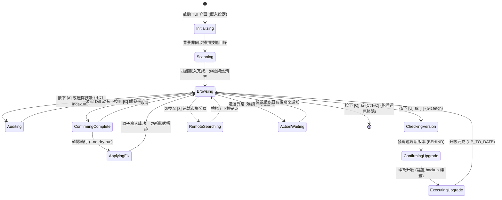

# SkillManager 更新計畫 (TUI Update Plan)

本文件依據 `workflow.md` 規範編寫，確立 **SkillManager** 從現行「單次執行命令列工具（CLI Tool）」升級演進為「現代終端文字使用者介面（TUI - Text User Interface）」之架構設計、互動模型、事件驅動解耦規範與分階段實施計畫。

- **目標版本**：`v0.3.0`
- **架構角色**：思考 / 架構決策 (Architecture & Design)
- **當前狀態**：草案核准 (Approved for Implementation)
- **核心目標**：實現全生命週期常駐終端之全域 AI 技能儀表盤（Dashboard）、分區即時審計與 Unified Diff 檢視、互動式一鍵自動補全/升級/回滾，以及遠端技能檢索即時預覽與安裝。

---

## 1. 需求背景與核心痛點分析

### 1.1 現行單次 CLI 模式之痛點
1. **多步驟操作斷裂與心智負擔 (Multi-step Discontinuity)**：
   - 使用者在排查或維護技能庫時，流程通常為：`scan`（列出全域技能）→ 複製特定目錄路徑 → `audit`（審計結構）→ 複製 `index.md` 路徑 → `complete`（執行補全）→ `track status`（檢查 Git 版本）→ `track upgrade`（執行升級）。
   - 每次操作皆為獨立的單次命令列調用，使用者必須頻繁在終端滾動、反白複製路徑、手動輸入複雜旗標（如 `--no-dry-run`、`--custom-paths`、`--target`），操作流暢度受限。
2. **終端字符限制與 Diff 預覽不易 (Limited Terminal Visuals)**：
   - 當 `audit` 產出長篇 Unified Diff 或多筆章節缺失時，單次命令列輸出容易被後續指令沖刷覆蓋；若輸出格式設為 `table`，過寬的欄位容易折行破版，缺乏可自由切換、捲動檢視的分區視窗。
3. **工作流技能審計缺乏可視化互動 (Lack of Interactive Workflow Matrix)**：
   - 現行 `workflow-audit` 指令以文字表格呈現 `INSTALLED`、`MISSING` 與 `INCOMPLETE`。若使用者僅想補全其中特定 1~2 項缺失技能，現行命令列僅能選擇全部補全（`--auto-complete`）或手動單項處理，缺乏核取清單（Checkbox List）式的選擇性補全體驗。
4. **遠端搜尋與本機安裝脫節 (Decoupled Remote Search & Install)**：
   - 執行 `search` 查詢 GitHub 或 HuggingFace 遠端技能後，終端僅顯示表格清單；使用者欲安裝時，仍需自行開啟瀏覽器複製網址、手動 `git clone` 至平台目錄，無法在同一介面中按下快捷鍵直接將遠端技能套件拉取至本機。

### 1.2 預期達成效益
- **全生命週期常駐儀表盤 (Resident TUI Workspace)**：
  - 啟動後常駐於終端，左側即時呈現跨平台技能清單（含健康狀態圖示 🟢/🟡/🔴/⚪），右側連動呈現詳細元數據、`SKILL.md` 內文與 Audit Diff。
- **直覺流暢的鍵盤熱鍵操作**：
  - `[A]` 立即審計、`[C]` 一鍵補全骨架、`[U]` 安全升級、`[R]` 一鍵回滾、`[O]` 原生檔案總管開啟目錄、`[/]` 即時關鍵字過濾。
- **異步非阻塞操作 (Non-blocking Async I/O)**：
  - 遠端 GitHub / HuggingFace 搜尋、Git fetch 網路同步均於背景工作執行緒（Worker）執行，配合旋轉進度指示器（Spinner），介面維持 60 FPS 流暢不卡頓。
- **平滑向下相容 (Zero Breaking Changes)**：
  - 完整保留所有現行 CLI 子命令（`scan`、`search`、`audit`、`complete`、`track`、`workflow-audit`、`config`、`healthcheck`）與 `--format json` 輸出，當偵測到無 TTY 環境（CI/CD、Pipe、背景排程）或指定子指令時自動回退為經典腳本模式。

---

## 2. 系統架構演進拓撲圖 (Architecture Topology)

```text
+-------------------------------------------------------------------------------+
|                    SkillManager 雙模互動架構拓撲圖 (v0.3.0)                    |
+-------------------------------------------------------------------------------+

                             [ 進入點: cli.py / main ]
                                        │
                    ┌───────────────────┴───────────────────┐
                    ▼                                       ▼
        [ 輸入帶有具體子指令 ]                      [ 無子指令或明確下達 tui ]
      (scan, search, audit, ...)                            │
                    │                           ┌───────────┴───────────┐
                    │                           ▼                       ▼
                    │               [ 環境判斷: TTY 檢測 ]     [ 參數判定: --no-tui ]
                    │                           │                       │
                    │              ┌────────────┴────────────┐          │
                    │              ▼ (具備 TTY 且未禁用)        ▼ (無 TTY / 管線模式)
                    │       [ TUI 互動模式: SkillManagerApp ]  [ 預設輸出 Help / 降級 ]
                    │       - 全螢幕緩衝 (Alternate Screen)   - 標準 Typer Help 訊息
                    │       - 響應式佈局 (Textual Grid)       - 退出碼 0 / 2
                    │       - 事件循環與鍵盤原生綁定           - 專供腳本與自動化管線
                    │       - 任務結束後維持常駐               
                    │              │                                    │
                    └──────────────┼────────────────────────────────────┘
                                   │
                                   ▼
                   [ 核心非同步配接層 (Async Core Adapter) ]
                   - ScannerWorker: 背景掃描與目錄監控
                   - RemoteSearchWorker: 串接 GitHub / HF API
                   - VersionWorker: Git fetch / reset / tag
                   - WorkflowWorker: 工作流解析與骨架補全
                                   │
                                   ▼
                     [ 核心事件匯流排 (Event Bus) ]
                     - on_skills_loaded (全域技能清單更新)
                     - on_audit_finished (審計結果與 Diff 產出)
                     - on_version_status (版本狀態轉移)
                     - on_log_message (分級日誌與警告事件)
                                   │
         ┌─────────────────────────┼─────────────────────────┐
         ▼                         ▼                         ▼
   [ core.scanner ]         [ core.indexer ]          [ core.versioning ]
   [ core.config ]          [ core.remote_search ]    [ core.workflow_auditor ]
```

---

## 3. UI/UX 介面佈局與元件規範 (Layout & Widgets)

### 3.1 終端視覺佈局結構 (Textual 雙欄響應式佈局)

```text
+---------------------------------------------------------------------------------------------------+
| [Header] SkillManager v0.3.0  [平台: 全部]                     [F1] 說明  [Tab] 切換視窗  [Q] 退出 |
+---------------------------------------+-----------------------------------------------------------+
| [Tabs: [1] 本機技能庫 | [2] 工作流審計 | [3] 遠端市集 | [4] 系統設定]                              |
+---------------------------------------+-----------------------------------------------------------+
| [Left: Skill List / Tree View (40%)]  | [Right Top: Skill Metadata & Overview (30%)]              |
| 快速過濾: [ agent-             ]     | 名稱: devin-code-reviewer          平台: antigravity      |
|                                       | 路徑: D:\_side-projects\skills\devin-code-reviewer        |
| 🟢 python-code-reviewer  (claude)     | 版本狀態: 🟡 BEHIND (落後遠端 3 個 Commit)                |
| 🟡 devin-code-reviewer   (antigrav)   | 本地 SHA: a8f91c2   遠端: https://github.com/...          |
| 🔴 git-workflow-helper   (cursor)     | YAML 描述: 自動化 Code Review 與安全性檢查 Agent          |
| ⚪ scratch-script-gen    (codex)      +-----------------------------------------------------------+
| 🟢 prompt-enhancer       (universal)  | [Right Bottom: Audit Diff & Resolution Panel (70%)]       |
|                                       | 規範比對: 符合度 75% | 缺失章節: 1 | 缺失目錄: 1            |
|                                       | --- a/SKILL.md                                            |
|                                       | +++ b/SKILL.md (補全預覽)                                 |
|                                       | @@ -15,0 +16,4 @@                                         |
|                                       | +## Instructions                                          |
|                                       | +詳細操作流程與步驟說明。                                 |
|                                       |                                                           |
|                                       | 缺失目錄結構: [!] scripts/ (待建立 .gitkeep)              |
+---------------------------------------+-----------------------------------------------------------+
| [Log / Status Panel - RichLog (即時通知與操作反饋)]                                               |
| [13:00:05] [INFO] 跨平台全域掃描完成：共探測 18 項技能，15 項合規，2 項缺失，1 項需更新。           |
| [13:00:12] [GIT]  正在檢測 devin-code-reviewer 遠端更新狀態 (fetch origin)...                   |
| [13:00:14] [WARN] devin-code-reviewer 發現 3 個可更新提交。                                       |
+---------------------------------------------------------------------------------------------------+
| [Footer - 互動快捷鍵導覽]                                                                         |
| [A] 結構審計  [C] 補全骨架  [U] 安全升級  [R] 版本回滾  [O] 開啟目錄  [/] 搜尋  [R] 重新掃描  [Q] 退出 |
+---------------------------------------------------------------------------------------------------+
```

### 3.2 狀態機生命週期 (State Machine Lifecycle)



---

## 4. 技術選型與環境相依評估

### 4.1 框架選型：Textual
- **開發團隊**：Textualize（目前專案已採用之終端格式化庫 `rich` 的原廠現代框架）。
- **關鍵特性**：
  - **異步事件驅動 (AsyncIO Native)**：原生支援 Python 3.15 `asyncio`，背景 I/O 操作與 UI 渲染完全解耦。
  - **宣告式 CSS 佈局 (TCSS)**：支援 Flexbox 與 CSS Grid 終端樣式排版，大幅降低視覺佈局維護成本。
  - **全螢幕緩衝區 (Alternate Screen Buffer)**：退出時乾淨復原使用者的原始終端畫面，0 殘留字符破版。
  - **豐富的內建元件**：`DataTable`、`Tree`、`RichLog`、`TabbedContent`、`Input`、`ProgressBar`。
- **相依套件影響**：
  - 新增相依：`textual>=0.80.0`
  - 純 Python 相依套件，無 C/C++ 編譯依賴，與既有 `rich>=15.0.0` 高度共用，Docker 映像檔增量小於 10 MB。

### 4.2 跨平台與容器相容性
- **Windows**：Windows Terminal 與 PowerShell 7 原生支援 ANSI 24-bit TrueColor 與滑鼠點擊/滾輪操作。
- **macOS / Linux**：支援標準 xterm-256color，支援快捷鍵無死鎖監聽。
- **Docker 容器**：目前 `docker-compose.yml` 已配置 TTY 與標準輸入支援：
  ```yaml
  stdin_open: true
  tty: true
  ```
  在 `docker exec -it skill-manager skill-manager tui` 下可無縫啟動全螢幕互動介面。

---

## 5. 核心模組重構與非同步配接規範 (Decoupling Specification)

為達成 TUI 與 CLI 雙模共用同一套核心業務邏輯，需將核心模組由原先直接印出控制台訊息改為「非同步回調與純資料結構回傳」。

### 5.1 事件資料結構 (`src/skill_manager/events.py`)

建立型別安全之純淨事件定義：

```python
from dataclasses import dataclass
from enum import Enum
from typing import Any, Dict, List, Optional
from skill_manager.models import SkillEntity, AuditResult, TrackResult

class UIMode(Enum):
    CLI = "cli"
    TUI = "tui"

@dataclass
class ScanProgressEvent:
    current_path: str
    scanned_count: int
    valid_count: int

@dataclass
class SkillSelectedEvent:
    skill: SkillEntity

@dataclass
class AuditCompleteEvent:
    skill_name: str
    audit_result: AuditResult

@dataclass
class VersionUpdateEvent:
    skill_name: str
    track_result: TrackResult

@dataclass
class LogEvent:
    level: str  # "DEBUG", "INFO", "WARNING", "ERROR"
    message: str
    timestamp: str
```

### 5.2 核心模組配接與非同步化
- **`core/scanner.py`**：
  - 新增非同步生成器 `async_scan_skills(...)`，在掃描每 10 個技能目錄時 yield 一次進度，供 TUI 即時更新載入進度條。
- **`core/versioning.py`**：
  - 將阻塞型 `repo.remotes.origin.fetch()` 封裝於 `asyncio.to_thread` 執行，避免網路延遲凍結 TUI 介面。
- **`core/remote_search.py`**：
  - 現行基於 `httpx` 之同步客戶端增加非同步介面 `async_search_github` 與 `async_search_huggingface`，支援邊輸入邊查詢之動態防手震（Debounce）搜尋。

---

## 6. TUI 互動功能實作規範

### 6.1 主要分頁與操作場景
1. **[Tab 1] 本機技能庫 (Local Skills Browser)**：
   - **清單面板**：以 `Tree` 或帶有顏色標記之 `DataTable` 呈現名稱、平台標籤、版本狀態與合規度。
   - **快捷搜尋**：按下 `/` 立即聚焦過濾框，支援依名稱或平台即時過濾。
   - **右側雙面板**：上方顯示元數據與路徑；下方顯示完整 `SKILL.md` 渲染或 Audit Unified Diff。
2. **[Tab 2] 工作流審計矩陣 (Workflow Auditor Matrix)**：
   - 自動探測當前專案之 `workflow.md`。
   - 以核取清單（Selection List）呈現所有宣告技能，使用者可逐一勾選欲補全之技能。
   - 按下 `[Enter]` 立即預覽補全 Diff，按下 `[C]` 執行實際建立與來源複製。
3. **[Tab 3] 遠端技能市集 (Remote Marketplace)**：
   - 提供搜尋列，即時查詢 GitHub 與 HuggingFace Hub。
   - 瀏覽搜尋結果之 Star 數、下載量與標籤。
   - 按下 `[I]` 彈出安裝目標平台選擇對話框，一鍵複製或 Clone 至目標技能目錄。
4. **[Tab 4] 系統設定 (Configuration)**：
   - 視覺化檢視各平台目錄映射路徑。
   - 快速切換預設輸出格式與 API Token 狀態檢驗。

### 6.2 快捷動作鍵映射表 (Global Keybindings)

| 按鍵 | 動作名稱 | 行為描述 |
| :---: | :--- | :--- |
| **`Tab` / `Shift+Tab`** | 切換焦點 | 在左側清單、右側面板、分頁列之間依序切換操作焦點 |
| **`1` ~ `4`** | 切換分頁 | 快速切換至「本機技能」、「工作流審計」、「遠端市集」、「系統設定」 |
| **`Enter`** | 深入檢視 / 確認 | 展開詳細資訊、確認對話框操作 |
| **`A`** | 結構審計 (Audit) | 比對選定技能之 `index.md`，即時在右下方渲染 Unified Diff |
| **`C`** | 自動補全 (Complete) | 彈出安全確認對話框，確認後以原子替換補全缺失章節與目錄骨架 |
| **`U`** | 安全升級 (Upgrade) | 檢查工作區變更，建立快照備份標籤並重置至遠端最新 Commit |
| **`R`** | 版本回滾 (Rollback) | 展開歷史備份標籤清單，選取並安全還原至指定快照點 |
| **`O`** | 開啟目錄 (Open) | 透過系統預設檔案總管開啟目前選中技能之本機目錄 |
| **`/`** | 搜尋過濾 (Filter) | 游標移至過濾輸入框，即時縮小清單範圍 |
| **`F5`** | 重新掃描 (Refresh) | 觸發非同步重新掃描，更新所有技能最新狀態 |
| **`Q` / `Esc`** | 退出 (Quit) | 安全退出 TUI 應用程式，乾淨復原終端螢幕 |

---

## 7. 分階段實施工作分解 (Work Breakdown Structure, WBS)

```text
v0.3.0 TUI 現代化實施排程
├── [階段 1] 核心模組事件化與非同步配接層
│   ├── 新增 src/skill_manager/events.py 定義標準 UI 事件與資料類別
│   ├── 於 src/skill_manager/core/ 建立 async_adapter.py 封裝非同步 Worker
│   └── 確保現行 93 項單元與整合測試維持 100% 通過（無回歸破壞）
├── [階段 2] Textual TUI 主應用與核心元件開發
│   ├── 建立 src/skill_manager/tui/app.py 主應用框架與自訂 TCSS 樣式
│   ├── 實作 src/skill_manager/tui/widgets/skill_tree.py (技能清單元件)
│   ├── 實作 src/skill_manager/tui/widgets/diff_viewer.py (Unified Diff 語法高亮檢視器)
│   ├── 實作 src/skill_manager/tui/widgets/workflow_view.py (工作流互動矩陣)
│   └── 實作跨平台原生檔案瀏覽器調用函式 (Windows/macOS/Linux)
├── [階段 3] 雙模入口整合與 CLI 無縫降級
│   ├── 升級 src/skill_manager/cli.py：
│   │   ├── 新增 skill-manager tui 指令
│   │   ├── 當無子指令且具備 TTY 時，預設直接啟動 TUI 介面
│   │   └── 新增 --no-tui 旗標與 isatty() 判定，無 TTY 時安全降級為經典 Help 輸出
│   └── pyproject.toml 更新相依宣告 (textual>=0.80.0)
└── [階段 4] 自動化測試、資安掃描與容器驗證
    ├── 新增 tests/unit/test_tui_app.py (使用 Textual Pilot 進行虛擬終端自動化測試)
    ├── 執行多輪回歸測試 (R1-R3) 與代碼行覆蓋率檢核 (維持整體 >= 80%, 核心 >= 90%)
    ├── 執行階段 4 資安審查 (uv audit 確認 0 CVE, 驗證路徑與指令防護)
    ├── 更新 Dockerfile 與 docker-compose.yml 驗證容器內 TUI 交互
    └── 更新 docs/06_deployment_guide.md 與 docs/07_changelog.md
```

---

## 8. 驗收標準 (Acceptance Criteria, AC)

- [ ] **AC-TUI-01 (全螢幕雙欄常駐)**：
  - **Given**：在 Windows Terminal、PowerShell、Linux 或 macOS 終端直接執行 `skill-manager` 或 `skill-manager tui`。
  - **When**：應用程式啟動。
  - **Then**：正確載入全螢幕 Alternate Screen，左側顯示本機技能樹，右側顯示元數據與 Diff 視窗，程序維持常駐等待使用者鍵盤互動。
- [ ] **AC-TUI-02 (即時結構審計與 Diff 呈現)**：
  - **Given**：使用者於清單選取不合規之技能並按下 `[A]` 鍵。
  - **When**：背景審計完成。
  - **Then**：右下方面板即時以紅綠色彩語法高亮渲染 Unified Diff，清楚標記缺失章節與目錄，無控制台文字噴版或破版現象。
- [ ] **AC-TUI-03 (互動式原子補全)**：
  - **Given**：選取缺失技能並按下 `[C]` 鍵。
  - **When**：使用者於確認彈窗選擇「確認執行」。
  - **Then**：調用 `complete_skill` 執行原子置換寫入，清單狀態圖示由 🔴 自動變更為 🟢，Diff 視窗清空或標註「已完全合規」。
- [ ] **AC-TUI-04 (非同步操作無凍結)**：
  - **Given**：在遠端市集分頁搜尋大量關鍵字，或針對多個 Git 技能執行版本比對。
  - **When**：網路請求進行中。
  - **Then**：介面顯示動態 Spinner，使用者仍可自由切換分頁、捲動檢視，介面幀率維持穩定不凍結。
- [ ] **AC-TUI-05 (雙模相容與管線降級)**：
  - **Given**：在無 TTY 環境（例如 CI/CD 指令 `skill-manager scan --format json | jq` 或無人值守腳本）。
  - **When**：執行指令。
  - **Then**：系統自動跳過 TUI 渲染，精確以標準 stdout 輸出純 JSON 或執行對應 CLI 邏輯，退出碼正確，無任何 TUI 初始化例外。
- [ ] **AC-TUI-06 (跨平台原生目錄開啟)**：
  - **Given**：選定特定技能並按下 `[O]` 鍵。
  - **When**：觸發動作。
  - **Then**：Windows 環境調用 `explorer.exe`、macOS 調用 `open`、Linux 調用 `xdg-open` 正確開啟並高亮選中目標技能目錄。
- [ ] **AC-TUI-07 (既有品質門檻維持)**：
  - **Given**：完成 TUI 相關代碼與套件擴充。
  - **When**：執行全專案自動化測試與資安掃描。
  - **Then**：既有 93 項測試案例 100% 通過，新增 TUI Pilot 測試案例全數通過，全套件覆蓋率維持 ≥ 85%，`uv audit` 維持 0 已知弱點。

